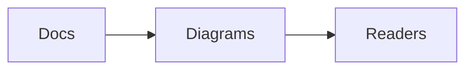

# All fences on one page

Every kind of fence this site uses, next to each other.

## DBML

```dbml title="shop.dbml"
Table users {
  id integer [pk]
  name varchar
}

Table orders {
  id integer [pk]
  user_id integer [ref: > users.id]
  total numeric
}

TableGroup sales [color: #1e3a8a] {
  orders
}
```

## DBML, shown as code

```dbml static
Table tags {
  id integer [pk]
}
```

## Mermaid



## Live code

```jsx live
function Counter() {
  const [count, setCount] = React.useState(0);
  return (
    <button className="live-counter" onClick={() => setCount((c) => c + 1)}>
      Clicked {count} times
    </button>
  );
}
```

## Plain code

```js title="hello.js"
export function hello(name) {
  return `Hello, ${name}!`;
}
```
